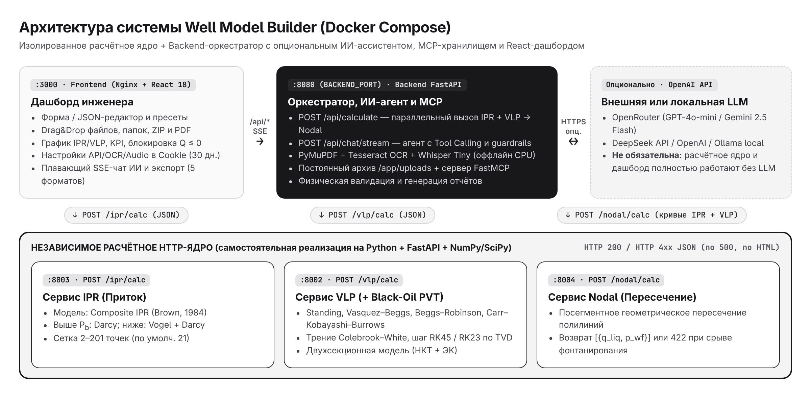

# Well Model Builder (v3.1)

Инженерная микросервисная система узлового анализа добывающей скважины («пласт — скважина») для расчёта кривых притока (**IPR**), подъёма газожидкостной смеси (**VLP** + **Black-Oil PVT**) и нахождения рабочей точки пересечения (**Nodal**).

Базовый расчёт, диагностика физики, импорт файлов, экспорт отчётов и веб-интерфейс работают **полностью оффлайн без ИИ-ключей**. Опционально подключается потоковый ИИ-ассистент (**SSE**), оффлайн-распознавание голоса (**Whisper Tiny**), **OCR-импорт** PDF и сканов (**PyMuPDF + Tesseract** / **Vision LLM**) и встроенный **MCP-сервер**.

---

## 1. Архитектура и состав системы

Все 3 расчётных сервиса (`IPR`, `VLP`, `Nodal`), `Backend`-оркестратор и `Frontend`-дашборд запускаются изолированно и взаимодействуют по REST/JSON.



### Сервисы и порты (`docker-compose.yml`)

| Сервис | Контейнер / Порт | Технологии | Назначение | Health / OpenAPI |
| :--- | :--- | :--- | :--- | :--- |
| **Frontend** | `well_frontend` · `3000:3000` | React 18, TypeScript, Vite, Recharts, Nginx | Веб-дашборд, вкладки фонда скважин, Drag&Drop-импорт, SSE-чат, кликабельное превью медиа | `http://localhost:3000` |
| **Backend** | `well_backend` · `${BACKEND_PORT:-8080}:8080` | Python 3.12, FastAPI, httpx, FastMCP, faster-whisper, Tesseract, PyMuPDF | Оркестрация расчётов, ИИ-агент, OCR/аудио, оптимизация, отчёты, MCP HTTP/stdio | `GET /health` · `/docs` |
| **VLP (+PVT)** | `well_vlp` · `8002:8002` | Python 3.12, FastAPI, NumPy, SciPy (`solve_ivp`) | Гомогенный многофазный подъём без скольжения + встроенный Black-Oil PVT | `GET /vlp/health` · `/docs` |
| **IPR** | `well_ipr` · `8003:8003` | Python 3.12, FastAPI, NumPy | Индикаторная кривая притока Composite IPR (Brown, 1984) | `GET /ipr/health` · `/docs` |
| **Nodal** | `well_nodal` · `8004:8004` | Python 3.12, FastAPI | Посегментное пересечение кривых IPR и VLP | `GET /nodal/health` · `/docs` |

> В [docker-compose.yml](docker-compose.yml) для хоста параметризован порт `${BACKEND_PORT:-8080}`; переменные `IPR_PORT`, `VLP_PORT`, `NODAL_PORT`, `FRONTEND_PORT` в [`.env.example`](.env.example) предназначены для раздельного локального запуска без Docker.


---

## 2. Структура репозитория

```text
├── backend/                 # FastAPI-оркестратор, ИИ-ассистент, OCR/Whisper, отчёты, MCP-сервер
│   ├── app/
│   │   ├── orchestrator/    # /api/calculate, /api/presets, клиент к IPR/VLP/Nodal
│   │   ├── ai_assistant/    # /api/chat, /api/chat/stream, парсеры 13+ форматов, guardrails, file_store
│   │   ├── enhancements/    # /api/enhancements/* (vision, audio, optimize, match, batch, report, economics и др.)
│   │   └── mcp_server.py    # FastMCP (stdio) + HTTP-роутер /api/mcp/* (в т.ч. raw-просмотр загрузок)
│   └── tests/               # Тесты оркестратора, инструментов, OCR, Whisper и новых фич
├── services/
│   ├── ipr/                 # Микросервис расчёта IPR + тесты
│   ├── vlp/                 # Микросервис расчёта VLP и PVT + тесты
│   └── nodal/               # Микросервис пересечения кривых + тесты
├── frontend/                # React + TypeScript + Vite + Nginx-прокси
│   └── src/components/      # Форма, график, KPI, настройки cookie, шторка инструментов, чат-виджет
├── samples/                 # Примеры скважин для автозагрузки фонда (well_01..well_03)
├── tests/                   # Контрактные, E2E и ТЗ-бенчмарк тесты
├── scripts/                 # Живой прогон бенчмарков (run_benchmarks.py)
├── docs/                    # Интеграция API, база знаний docs/kb/, диаграммы и презентация
└── uploads/                 # Хранилище загруженных через чат/Vision/Audio файлов
```

---

## 3. Быстрый старт и настройка окружения

### Требования
- **Docker >= 24** и **Docker Compose v2** — для запуска всего стека одной командой;
- Либо **Python 3.12+** и **Node.js 20+** — для раздельного запуска сервисов.

### Шаг 1. Переменные окружения (опционально)
Приватные ключи в репозиторий не входят; шаблон — [`.env.example`](.env.example):

```bash
cp .env.example .env
```

Основные переменные:
- `IPR_SERVICE_URL`, `VLP_SERVICE_URL`, `NODAL_SERVICE_URL` — адреса ядра для оркестратора (в Docker: `http://ipr:8003`, `http://vlp:8002`, `http://nodal:8004`).
- `BACKEND_PORT=8080` — внешний порт бэкенда на хосте.
- `LLM_BASE_URL`, `LLM_MODEL`, `LLM_API_KEY` — OpenAI-совместимый шлюз и ключ (если `LLM_API_KEY` пуст, вся расчётная, импортная и отчётная функциональность продолжает работать без ИИ).
- `LLM_TIMEOUT_SEC=30`, `AI_MAX_STEPS=6`, `UPLOAD_STORAGE_DIR=/app/uploads`.

### Шаг 2. Запуск в Docker Compose

```bash
# Полный стек (Frontend + Backend + VLP + IPR + Nodal)
docker compose up -d --build

# Если порт 8080 на хосте занят:
BACKEND_PORT=18080 docker compose up -d --build

# Только 3 расчётных микросервиса ядра:
docker compose up -d --build ipr vlp nodal
```

### Шаг 3. Проверка готовности
```bash
curl http://localhost:8080/health
curl http://localhost:8002/vlp/health
curl http://localhost:8003/ipr/health
curl http://localhost:8004/nodal/health
```

---

## 4. Руководство пользователя

### Работа с дашбордом (работает и без ИИ-ключей)
1. Откройте **http://localhost:3000**.
2. В верхней панели **«Фонд скважин»** отображаются вкладки скважин из `samples/` (или пакетно загруженных файлов) в стиле вкладок браузера с расчётным дебитом; кнопка `+` открывает импорт, кнопка **«Сводка фонда»** — пакетный расчёт.
3. В левой колонке вкладки **«Главная»** задайте параметры во вкладке **«Форма»**, отредактируйте структуру во вкладке **«JSON»** (с проверкой полноты полей без подмены значений) или выберите готовый пресет (`well_01`, `WCT 90%`, `Без пересечения`).
4. Нажмите **«Рассчитать модель скважины»** — справа отобразятся KPI-карточки, график **IPR / VLP** и рабочая точка (`q_liq`, `p_wf`).
   - При **нефизичных сочетаниях** (`P_b > P_res`, рассогласовании `WCT`) или **отсутствии пересечения** (`no_intersection`) интерфейс **не блокирует** расчёт, график и экспорт, а выводит явные предупреждающие баннеры.
5. В левой навигации (`.side-rail`) доступны разделы:
   - **Инструменты** — выдвижная панель из 7 инженерных модулей: `01 Оптимизация НКТ`, `02 Факт. замер` (History Matching), `03 Сценарии «Что если»`, `04 Фонд скважин` (пакетный расчёт и сводный Excel), `05 Импорт файлов`, `06 Сканер файлов`, `07 Протокол совещания`.
   - **База методик** — локальный поиск (RAG) по методикам [`docs/kb/`](docs/kb/).
   - **Импорт** — шторка пакетного импорта (`Drag&Drop`, файлы, папка, `.zip`, фото паспорта и `.pdf` с выбором режима OCR: `PyMuPDF + Tesseract` или `Vision LLM`).
   - **Отчёты** — выгрузка паспорта скважины в 5 форматах: **HTML+SVG**, **XLSX**, **CSV**, **JSON**, **Markdown**.
   - **Настройки** — выбор пресета провайдера ИИ, режимов **Whisper / PDF OCR**, сохранение в cookie (на 30 дней), просмотр загруженных файлов сервера (`MCP`) и сброс сохранённой сессии.

### Работа с плавающим чатом «Ассистент»
1. Кнопка **«Ассистент»** в правом нижнем углу открывает перетаскиваемое и расширяемое окно консультанта (`POST /api/chat/stream`).
2. Можно отправлять текст, JSON, голосовые сообщения (микрофон / аудиофайл) и фото/документы (`Drag&Drop` или иконки в окне ввода):
   - Все загруженные изображения и файлы **кликабельны** прямо в переписке (кнопка `Открыть` для фото открывает лайтбокс, клик по файлу открывает/скачивает оригинал через `/api/mcp/file/.../raw`).
   - При загрузке посторонней картинки или неполного JSON/текста ассистент **не придумывает недостающие параметры** (возвращает `not_found` / список недостающих полей), а частичные параметры объединяет с текущей моделью через `mergeWellParams` без потери инклинометрии.

---

## 5. Swagger / OpenAPI документация и контракты

Интерактивная документация **Swagger UI** и схемы **OpenAPI 3.1** подняты на каждом HTTP-сервисе:

| Сервис | Swagger UI | OpenAPI JSON |
| :--- | :--- | :--- |
| **Backend (оркестратор, AI, MCP, аналитика)** | http://localhost:8080/docs | http://localhost:8080/openapi.json |
| **VLP (+PVT)** | http://localhost:8002/docs | http://localhost:8002/openapi.json |
| **IPR** | http://localhost:8003/docs | http://localhost:8003/openapi.json |
| **Nodal** | http://localhost:8004/docs | http://localhost:8004/openapi.json |

Подробное описание контрактов и примеров запросов — в [docs/FRONTEND_INTEGRATION.md](docs/FRONTEND_INTEGRATION.md).

### Формат ошибок 4xx (раздел 5 ТЗ)
При ошибках валидации, отсутствии пересечения (на уровне `/nodal/calc`) и некорректном JSON сервисы возвращают JSON-ответ `4xx`:
```json
{
  "message": "Ошибка валидации",
  "description": "body -> wct: Value error, wct должно быть в диапазоне от 0 до 100",
  "detail": "body -> wct: Value error, wct должно быть в диапазоне от 0 до 100"
}
```

### Основные маршруты
- **Ядро:** `POST /ipr/calc` (`:8003`), `POST /vlp/calc` (`:8002`), `POST /nodal/calc` (`:8004`) — сетка `points` от `2` до `201` (по умолчанию `21`).
- **Оркестратор (`:8080`):** `POST /api/calculate` (параллельный вызов IPR + VLP -> Nodal + `meta.warnings` / `meta.is_physical`), `GET /api/presets`, `GET /api/presets/{preset_id}`.
- **ИИ-чат и загрузка:** `GET /api/chat/status`, `POST /api/chat`, `POST /api/chat/stream` (SSE: `session` → `status` → `tool_start` → `tool_end` → `delta` → `done` c `tool_trace` и `usage`), `POST /api/chat/upload`, `POST /api/chat/upload/calculate`.
- **Инструменты и аналитика (`/api/enhancements/*`):** `/vision`, `/audio`, `/scan`, `/optimize`, `/match`, `/protocol`, `/batch`, `/batch/excel`, `/report/{markdown,excel,html,csv,json}`, `/economics`, `/flow-assurance`, `/vfm`, `/monte-carlo`, `/gtm`.
- **MCP (`:8080` + stdio `python -m app.mcp_server`):** `GET /api/mcp/tools`, `GET /api/mcp/files`, `GET /api/mcp/files/{file_ref}`, `GET /api/mcp/file/{file_ref}/raw` (inline-превью с проверкой `is_relative_to`), `POST /api/mcp/call`.
