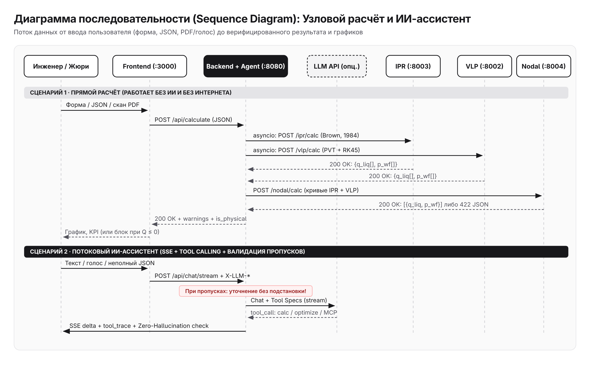

# Well Model Builder (v3.1)

Инженерная микросервисная система узлового анализа «пласт — скважина» для расчёта кривых притока (**IPR**), подъёма газожидкостной смеси (**VLP** + **Black-Oil PVT**) и нахождения рабочей точки пересечения (**Nodal**). Система полностью работает в базовом режиме **без ИИ-ассистента и интернета**, а также дополнена опциональным потоковым ИИ-ассистентом (SSE), оффлайн-распознаванием голоса (**Whisper Tiny**), **OCR-импортом PDF**, локальным **MCP-сервером** и защитой от нефизичных расчётов.

---

## 1. Назначение, состав решения и архитектура

Система решает задачу сквозного узлового анализа добывающей скважины — от ввода или импорта промысловых данных до построения кривых IPR/VLP, калибровки по замеру, оптимизации режима и выгрузки отчётов.

Все 3 расчётных сервиса (`IPR`, `VLP`, `Nodal`), `Backend`-оркестратор и `Frontend`-дашборд разработаны командой самостоятельно и запускаются раздельно.


### Компоненты и порты по умолчанию

| Сервис | Порт (`.env.example`) | Технологии | Назначение | Health / OpenAPI |
| :--- | :--- | :--- | :--- | :--- |
| **Frontend** | `3000` (`FRONTEND_PORT`) | React 18, TypeScript, Vite, Recharts, Nginx | Веб-дашборд, Drag&Drop, cookie-настройки, SSE reverse-proxy | `http://localhost:3000` |
| **Backend** | `8080` (`BACKEND_PORT`) | Python 3.12, FastAPI, httpx, FastMCP, faster-whisper, Tesseract | Оркестрация расчётов, валидация физики, ИИ-агент, OCR/аудио, отчёты | `GET /health` · `/docs` |
| **VLP (+PVT)** | `8002` (`VLP_PORT`) | Python 3.12, FastAPI, NumPy, SciPy (`solve_ivp`) | Многофазный подъём без скольжения + встроенный Black-Oil PVT | `GET /vlp/health` · `/docs` |
| **IPR** | `8003` (`IPR_PORT`) | Python 3.12, FastAPI, NumPy | Индикаторная кривая притока Composite IPR (Brown, 1984) | `GET /ipr/health` · `/docs` |
| **Nodal** | `8004` (`NODAL_PORT`) | Python 3.12, FastAPI | Посегментное пересечение полилиний IPR и VLP | `GET /nodal/health` · `/docs` |

### Диаграмма последовательности (Sequence Diagram)



---

## 2. Установка, настройка окружения и запуск (без помощи команды)

### Требования
- Docker `>= 24` и Docker Compose v2 (для полного запуска в контейнерах)
- Либо Python `3.12+` и Node.js `20+` (для раздельного локального запуска)

### Шаг 1. Подготовка переменных окружения (`.env.example`)
В поставке **нет** приватных API-ключей — используется только шаблон [`.env.example`](.env.example). При желании скопируйте его в `.env`:

```bash
cp .env.example .env
```

Основные переменные окружения:
- `IPR_SERVICE_URL`, `VLP_SERVICE_URL`, `NODAL_SERVICE_URL` — адреса расчётных сервисов для оркестратора (в Docker: `http://ipr:8003`, `http://vlp:8002`, `http://nodal:8004`).
- `BACKEND_PORT`, `FRONTEND_PORT`, `VLP_PORT`, `IPR_PORT`, `NODAL_PORT` — внешние порты контейнеров (по умолчанию `8080`, `3000`, `8002`, `8003`, `8004`).
- `LLM_BASE_URL`, `LLM_MODEL`, `LLM_API_KEY` — адрес, модель и ключ OpenAI-совместимого провайдера (если ключ пуст — ИИ-чат остаётся опциональным, всё расчётное ядро и UI работают штатно).
- `LLM_TIMEOUT_SEC=30`, `AI_MAX_STEPS=6`, `UPLOAD_STORAGE_DIR=/app/uploads`.

### Шаг 2. Запуск одной командой в Docker Compose

```bash
docker compose up -d --build
```

> Если порт `8080` на хосте занят сторонним сервисом, задайте другой хост-порт без правки кода:
> `BACKEND_PORT=18080 docker compose up -d --build`

Если нужно поднять **только три расчётных HTTP-сервиса**:
```bash
docker compose up -d --build ipr vlp nodal
```

### Шаг 3. Проверка готовности
```bash
curl http://localhost:8080/health
curl http://localhost:8002/vlp/health
curl http://localhost:8003/ipr/health
curl http://localhost:8004/nodal/health
```

---

## 3. Руководство пользователя и администратора

### Вариант А: Работа с системой БЕЗ ИИ-ассистента (оффлайн / без ключей)
1. Откройте дашборд **http://localhost:3000**.
2. В левой колонке введите параметры вручную во вкладке **«Форма»**, вставьте JSON во вкладке **«JSON»**, выберите готовый пресет (`well_01`, `WCT 90%`, `Без пересечения`) или перетащите файл/папку/`.zip`/PDF в верхний блок импорта.
3. Нажмите **«Рассчитать модель скважины»** — оркестратор выполнит `POST /api/calculate`, построит кривые **IPR / VLP** и выведет карточку рабочей точки (`q_liq`, `p_wf`) или явное предупреждение при отсутствии пересечения / нарушении физики.
4. Перейдите в **«Инструменты»** и **«Отчёты»** — доступны What-If, оптимизация НКТ ГОСТ, History Matching, оценка Flow Assurance (Тернер + API RP 14E), виртуальный расходомер VFM, Монте-Карло (`P10`/`P50`/`P90`), пакетный расчёт и экспорт отчётов в 5 форматах (**HTML+SVG**, **XLSX**, **CSV**, **MD**, **JSON**).

### Вариант Б: Настройка и работа с ИИ-ассистентом (через UI без правки `.env`)
1. Откройте **«Настройки»** на левой панели навигации (или шестерёнку в шапке плавающего чата).
2. Выберите провайдера (**OpenRouter GPT-4o-mini**, **OpenRouter Gemini 2.5 Flash**, **DeepSeek API**, **OpenAI** или локальную **Ollama**) и при необходимости укажите свой **API Key**, **Base URL**, режим распознавания речи (**Whisper Tiny** / **Multimodal LLM**) и OCR для PDF (**PyMuPDF + Tesseract** / **Vision LLM**).
3. Нажмите **«Сохранить в Cookie (30 дней)»** — параметры передаются в `X-LLM-*` заголовках и теле запроса и не сбрасываются при обновлении страницы.
4. Откройте плавающий виджет **«Ассистент»** (правый нижний угол) и введите запрос текстом, JSON или голосом:
   - при неполном JSON/тексте ассистент проверяет обязательные поля и **запрашивает уточнение**, не подставляя значения по умолчанию без согласия;
   - при наличии расчёта или оптимизации обновляет форму и график, показывая живой SSE-стрим и трассировку вызовов (`tool_trace`).

---

## 4. Контракты API (OpenAPI 3.1) и примеры запросов

Интерактивная спецификация Swagger доступна на каждом сервисе по `/docs` (`/openapi.json`):
- Оркестратор: `http://localhost:8080/docs` (см. также [docs/FRONTEND_INTEGRATION.md](docs/FRONTEND_INTEGRATION.md))
- IPR: `http://localhost:8003/docs` · VLP: `http://localhost:8002/docs` · Nodal: `http://localhost:8004/docs`

### Формат ошибок (Единый стандарт раздела 5 ТЗ)
При любых ошибках валидации, отсутствии пересечения кривых или синтаксически некорректном JSON сервисы возвращают структурированный **HTTP 4xx** (`Content-Type: application/json`, никогда HTML или `500`):
```json
{
  "message": "Ошибка валидации",
  "description": "body -> wct: Value error, wct должно быть в диапазоне от 0 до 100",
  "detail": "body -> wct: Value error, wct должно быть в диапазоне от 0 до 100"
}
```

### 4.1. `POST /ipr/calc` (Сервис IPR `:8003`)
```bash
curl -s -X POST http://localhost:8003/ipr/calc \
  -H "Content-Type: application/json" \
  -d '{"p_res": 200, "wct": 50, "pi": 1.0, "pb": 150, "points": 21}'
```
Ответ `200 OK`: `{"q_liq": [139.98, ..., 0.0], "p_wf": [1.0, 10.95, ..., 200.0]}` (сетка от `2` до `201` точек, по умолчанию `21`).

### 4.2. `POST /vlp/calc` (Сервис VLP `:8002`)
```bash
curl -s -X POST http://localhost:8002/vlp/calc \
  -H "Content-Type: application/json" \
  -d '{
    "inclinometry": {"MD": [0, 1000, 1500], "TVD": [0, 1000, 1100]},
    "casing": {"d": 0.1},
    "tubing": {"d": 0.062, "h_mes": 1000},
    "pvt": {"wct": 50, "rp": 100, "gamma_oil": 0.8, "gamma_gas": 0.7, "gamma_wat": 1.0, "t_res": 90},
    "p_wh": 10, "geo_grad": 3.0, "h_res": 1500, "roughness": 0.0001, "q_max": 400, "points": 21
  }'
```
Единицы: давление — `атм`, длина — `м`, температура — `°C`, дебит — `м³/сут`, `wct` — `%`, `rp` — `м³/т` (внутри PVT пересчитывается в `м³/м³` через `gamma_oil`).

### 4.3. `POST /nodal/calc` (Сервис Nodal `:8004`)
Принимает `{"ipr": {"q_liq": [...], "p_wf": [...]}, "vlp": {"q_liq": [...], "p_wf": [...]}}`, возвращает массив с **ровно одной точкой**: `[{"q_liq": 127.78, "p_wf": 50.27}]` либо `422` при отсутствии пересечения.

### 4.4. `POST /api/calculate` (Оркестратор `:8080`)
Принимает `{"ipr": ..., "vlp": ...}`, параллельно запрашивает IPR и VLP через `asyncio.gather`, находит рабочую точку в Nodal, добавляет `meta.warnings` и `meta.is_physical`.

### 4.5. `POST /api/chat/stream` (Потоковый ИИ-ассистент SSE `:8080`)
Принимает `{"message": "...", "params": {...}, "session_id": "...", "llm_config": {...}}`, отдаёт SSE-события `session` → `status` → `tool_start` → `tool_end` → `delta` → `done` (включая `tool_trace` и `usage`).

---

## 5. ИИ-ассистент: модель, инструменты, безопасность и стоимость

- **Конфигурируемая OpenAI-совместимая модель:** по умолчанию `openai/gpt-4o-mini` (рекомендуемая модель по балансу Tool Calling / Vision / цены), без правки кода переключается на `google/gemini-2.5-flash`, `deepseek-chat`, `OpenAI` или локальную `Ollama` (`qwen2.5:14b`).
- **Инструменты (Tools) агента (16 шт.):**
  1. `validate_well_params` — проверка полноты и физической согласованности входных данных.
  2. `calculate_well_model` — расчёт через `/api/calculate`.
  3. `run_what_if_scenario` — расчёт дельт `q_liq` и `p_wf` для сценариев «что если».
  4. `optimize_well_parameters` — перебор НКТ ГОСТ (48–114 мм), оптимального `P_wh`, `WCT_crit`.
  5. `apply_optimal_parameters` — применение параметров в UI с проверкой физики.
  6. `compare_with_field_measurement` — History Matching и оценка скин-фактора / калибровка `PI`.
  7. `search_methodology_kb` — локальный RAG по базе знаний [`docs/kb/`](docs/kb/).
  8. `list_server_files`, `read_server_file`, `search_server_files` — **MCP-инструменты** доступа к загруженным PDF-паспортам (`/app/uploads`) и `samples/`.
  9. `generate_meeting_protocol` — структурирование протокола по стенограмме/аудио.
  10. `calculate_unit_economics`, `evaluate_flow_assurance`, `estimate_virtual_flow`, `run_monte_carlo_analysis`, `generate_gtm_application` — прикладная инженерная аналитика.
- **Защита от галлюцинаций и пропусков:**
  - при неполном JSON/тексте возвращается перечень недостающих полей без подстановки значений из формы;
  - числовые факты сверяются со значениями инструментов (`redact_unsupported_numbers` + `guardrails.py`), prompt-injection и ПДн изолируются/маскируются.
- **Оценка стоимости одного обращения к ИИ-ассистенту:**
  - Средний диалог с 1–2 вызовами инструментов потребляет `~1 400` входных и `~350` выходных токенов (`~1 750 total tokens`; счётчик передаётся в поле `usage`).
  - `openai/gpt-4o-mini` (`$0.15 / $0.60` за 1M ток.): **~0.00042 $ (~0.04 ₽ / запрос)**.
  - `google/gemini-2.5-flash`: **~0.00042 $ (~0.04 ₽ / запрос)**.
  - `deepseek-chat` (`$0.27 / $1.10` за 1M ток.): **~0.00076 $ (~0.07 ₽ / запрос)**.
  - Локальная модель **Ollama** (`qwen2.5:14b`): **0 ₽** (полностью локально).
  - Расчётное ядро, оффлайн **Whisper Tiny** (`CPU int8`) и **Tesseract OCR**: **0 ₽**.

---

## 6. Физические методики, тесты и известные ограничения

- **Методики:** Composite IPR (Brown, 1984); Black-Oil PVT (Standing, Vasquez–Beggs, Beggs–Robinson, Carr–Kobayashi–Burrows); гомогенная VLP без скольжения, Colebrook–White, `RK45` / `RK23` по `TVD`.
- **Точность на эталоне `well_01`:** `q_liq = 127.78 м³/сут` (`0.20%` отклонения), `p_wf = 50.27 атм` (`1.32%` отклонения) при допуске ТЗ `<= 10%`.

### Запуск всех автотестов
```bash
# 1. Тесты микросервисов IPR/VLP/Nodal и контрактные/E2E/эталонные тесты (37 тестов)
pytest services/ipr/tests services/vlp/tests services/nodal/tests tests/ -v

# 2. Тесты бэкенд-оркестратора, ИИ, MCP, OCR, Whisper и отчётов (27 тестов)
PYTHONPATH=backend pytest backend/tests/ -v

# 3. Проверка сборки фронтенда
cd frontend && npm run build
```

### Известные ограничения
1. **Гидравлика VLP:** по спецификации задачи используется гомогенная модель смеси без скольжения фаз, идеальный газ (`z = 1`) и несжимаемая вода (переход к механизированной добыче ЭЦН/ШГН и корреляциям со скольжением вынесен в развитие).
2. **Оффлайн-распознавание голоса и сканов:** модель `Whisper Tiny` (`int8` на CPU) уступает крупным облачным моделям на сильном фоновом шуме; качество `Tesseract OCR` зависит от разрешения скана (`>= 150 DPI`). При наличии ключа можно в UI переключиться на Vision/Audio LLM.
3. **Максимальный размер загружаемого файла/архива:** `25 МБ` (лимит `MAX_UPLOAD_BYTES` и Nginx `client_max_body_size`).
4. **ИИ-часть опциональна:** без заданного API-ключа или URL локальной Ollama чат не отвечает как LLM (за исключением детерминированных команд валидации/оптимизации), однако вся расчётная, импортная и отчётная функциональность работает на 100%.

---

## 7. Материалы для защиты и тестирования

- Презентация в трёх форматах (12 слайдов по структуре ТЗ): **[HTML](docs/presentation.html)** · **[PDF](docs/presentation.pdf)** · **[PPTX](docs/presentation.pptx)**
- Речёвка выступления и ответы на Q&A: **[docs/SPEECH_DEFENSE.md](docs/SPEECH_DEFENSE.md)**
- Карта UI-стилей для дизайнера: **[docs/DESIGNER_TZ.md](docs/DESIGNER_TZ.md)**
- Набор 13 тестовых файлов (`.json`, `.txt`, `.csv`, `.xlsx`, `.docx`, `.pdf`, скан-`.pdf`, `.png`, `.jpg`, `.zip`, `.wav`, `.ogg`, нефизичный `WCT=120%`): **[test_import_files/](test_import_files/)**
